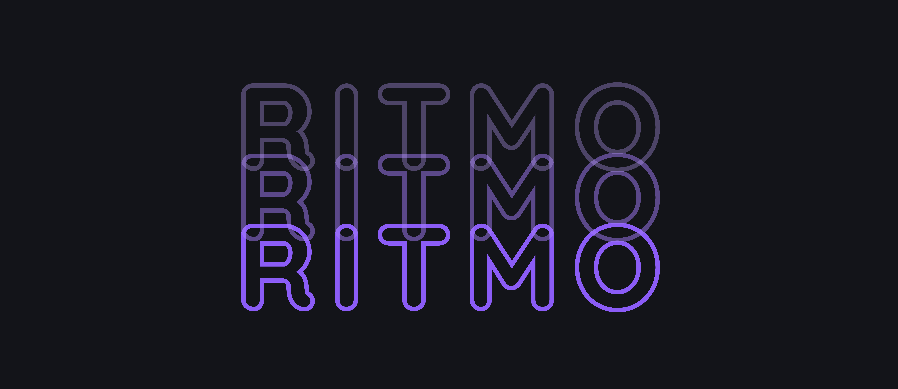
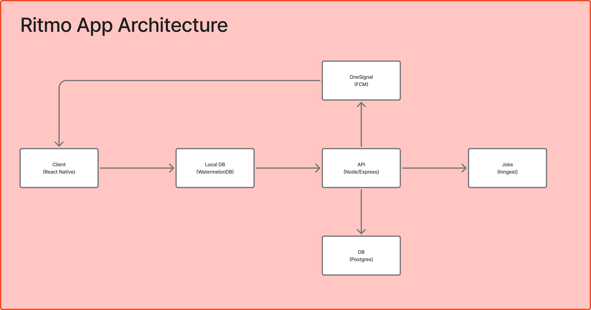

 

# Descrição
O Ritmo App é o seu espaço aconchegante para construir hábitos e organizar a rotina. Com um visual relaxante e cozy, o app transforma produtividade em algo leve e prazeroso, sem a pressão ou a frieza dos apps tradicionais.

Crie novos hábitos, monte cronogramas, defina lembretes e organize suas tarefas em um único lugar, tudo em um ambiente pensado para trazer calma ao seu dia a dia. Porque construir uma rotinha melhor não precisa ser estressante, pode ser, literalmente, confortável.

 

# Backlog
[Veja Aqui](./docs/backlog.md)

 

# Sprint Backlog

## Sprint 1

| ID | User Story | Prioridade | Requisito | Story Points |
|---|---|---|---|---|
| US01 | Como usuário, eu quero criar, editar, excluir, pausar e reativar hábitos definindo nome, descrição, frequência, duração, horário, dias, prioridade e categoria, para que eu possa organizar minha rotina de forma flexível. | High | RF01 | 8 |
| US02 | Como usuário, eu quero criar agendas semanais ou mensais com hábitos e eventos (únicos ou recorrentes), incluindo data, hora, local e notificações, para que minha rotina fique organizada em uma linha do tempo única. | High | RF02 | 8 |
| US03 | Como usuário, eu quero visualizar diariamente meus hábitos e eventos agendados e registrar cada hábito como concluído, parcialmente concluído ou não concluído, com horário e observações, para que eu acompanhe minha execução diária. | High | RF03 | 8 |
| US04 | Como usuário, eu quero visualizar minha taxa de consistência, sequências atuais e maiores sequências já alcançadas, para que eu entenda minha evolução ao longo do tempo. | High | RF04 | 5 |
| US05 | Como usuário, eu quero definir metas de curto, médio e longo prazo para hábitos individuais e para grupos de hábitos, para que eu possa acompanhar meu progresso rumo a objetivos específicos. | Medium | RF05 | 5 |
| US07 | Como usuário, eu quero receber um resumo semanal do meu progresso, para que eu tenha uma visão consolidada da minha semana. | Medium | RF06 | 3 |
| US14 | Como usuário, eu quero registrar o motivo pelo qual não concluí um hábito, para que o sistema possa analisar padrões de obstáculos. | Medium | RF10 | 2 |
| US18 | Como usuário, eu quero criar hábitos condicionais e em cadeia, que só podem ser marcados após outro hábito ou quando uma condição for satisfeita, para que eu modele dependências reais da minha rotina. | Low | RF13 | 8 |
| US19 | Como usuário, eu quero configurar hábitos-gatilho de preparação, para que eu seja preparado antes de realizar hábitos dependentes. | Low | RF13 | 5 |
| US21 | Como usuário, eu quero adicionar uma anotação geral ao final de cada dia, associada ao resumo diário, para que eu registre reflexões e possa consultá-las depois. | Medium | RF15 | 2 |
| US26 | Como usuário, eu quero criar um modelo de dia ideal com horários para hábitos e eventos, para que eu tenha uma referência de rotina planejada. | Medium | RF19 | 5 |
| US28 | Como usuário, eu quero selecionar um hábito como foco do dia, com destaque visual e lembretes adicionais, para que eu direcione minha atenção prioritária. | Medium | RF20 | 3 |

## Sprint 2

| ID | User Story | Prioridade | Requisito | Story Points |
|---|---|---|---|---|
| US06 | Como usuário, eu quero receber lembretes adaptativos baseados no meu histórico de conclusão, incluindo avisos de preparação, foco, prioridade e proximidade de sequências, para que eu seja lembrado no momento mais relevante. | Medium | RF06 | 8 |
| US10 | Como usuário, eu quero receber sugestões de horários ideais e alternativos para meus hábitos com base em meu histórico, conflitos e intervalos livres, para que eu otimize minha agenda. | Low | RF08 | 5 |
| US11 | Como usuário, eu quero receber recomendações automáticas de aumento ou redução de frequência/duração dos hábitos com base na minha consistência e carga total, para que minha rotina permaneça sustentável. | Low | RF08 | 5 |
| US12 | Como usuário, eu quero classificar meus hábitos em categorias e visualizar relatórios de equilíbrio entre elas, para que eu identifique áreas da vida pouco cuidadas. | Medium | RF09 | 5 |
| US13 | Como usuário, eu quero receber sugestões de hábitos em categorias pouco representadas, para que eu tenha uma rotina mais equilibrada. | Medium | RF09 | 3 |
| US15 | Como usuário, eu quero receber sugestões de ajustes e ações corretivas com base nos motivos de não conclusão registrados, para que eu supere os obstáculos identificados. | Medium | RF10 | 5 |
| US16 | Como usuário, eu quero visualizar minha semana em uma visão consolidada, um mapa de calor de consistência e relatórios de produtividade com gráficos interativos, para que eu compreenda meu desempenho geral. | High | RF11 | 8 |
| US22 | Como usuário, eu quero comparar minha consistência e tempo gasto entre semanas ou meses diferentes, identificando tendências de melhoria ou declínio, para que eu avalie minha evolução ao longo do tempo. | Medium | RF16 | 5 |
| US27 | Como usuário, eu quero visualizar diariamente o desvio entre meu dia ideal e minha execução real, para que eu identifique onde estou me afastando do planejado. | Medium | RF19 | 5 |
| US29 | Como usuário, eu quero visualizar o histórico de alterações de hábitos e eventos e reverter para versões anteriores, para que eu tenha controle sobre a evolução das minhas configurações. | Low | RF21 | 8 |
| US30 | Como usuário, eu quero receber recomendações de novos hábitos com base em baixa consistência, categorias ausentes e meus interesses declarados, para que eu descubra novos hábitos relevantes. | Low | RF22 | 5 |
| US33 | Como usuário, eu quero visualizar a estimativa de impacto de cada hábito na minha produtividade geral, destacando os mais transformadores, para que eu priorize os hábitos que mais me beneficiam. | Low | RF24 | 5 |
| US34 | Como usuário, eu quero receber sugestões de pausas curtas após sequências de hábitos, considerando duração acumulada e meu estado de movimento, para que eu evite fadiga excessiva. | Low | RF25 | 5 |
| US39 | Como usuário, eu quero visualizar correlações entre a conclusão de diferentes hábitos, para que eu identifique relações relevantes entre meus comportamentos. | Low | RF29 | 8 |
| US40 | Como usuário, eu quero salvar conjuntos de hábitos e eventos como modelos de rotina e carregá-los em dias ou semanas específicas, para que eu reaplique rotinas que já funcionaram bem. | Medium | RF30 | 5 |
| US42 | Como usuário, eu quero converter um evento único em uma série de hábitos preparatórios com datas de vencimento, para que eu me organize com antecedência para compromissos importantes. | Low | RF32 | 5 |
| US43 | Como usuário, eu quero que o sistema detecte períodos prolongados sem conclusão de um hábito e me envie incentivo com sugestão de reinclusão gradual, para que eu retome hábitos abandonados sem sobrecarga. | Medium | RF33 | 8 |

 

# Arquitetura

 

# Tecnologias

**Front-end:**
- React Native
- React Navigation
- Nativewind
- WaterMelonDB
- Zustand
- React Hook Form
- Axios
- Tanquery Stack

 

**Back-end:**
- Node Express
- TypeScript
- Prisma
- Zod
- Vitest + Supertest
- Pino
